# UNIVERSIDAD [NOMBRE DE LA UNIVERSIDAD]
## FACULTAD DE INGENIERÍA Y SISTEMAS
### TRABAJO FINAL: INGENIERÍA DE SOFTWARE II

**Proyecto:** Modernización y Refactorización del ERP "Finca la Primavera"  
**Autor:** [Nombre del Alumno]  
**Docente:** [Nombre del Docente]  
**Fecha:** 10 de Abril, 2026  

---

## 1. Introducción y Requisitos
El presente documento detalla la transformación técnica del sistema ERP de la Finca la Primavera, originalmente construido sobre una arquitectura monolítica y migrado hacia un diseño modular basado en principios SOLID, utilizando Django y React.

### 1.1 Matriz de Trazabilidad de Requisitos (MTR)
A continuación se presenta la vinculación técnica entre los requerimientos del negocio y su implementación física en los módulos de software.

#### 1.1.1 Requerimientos Funcionales (RF)

| ID | Prioridad | Módulo | Implementación (Backend/Frontend) | Estado |
|:---|:---:|:---|:---|:---:|
| RF-01 | Crítica | Granja | `models.LoteCerdos` / `AnimalForm.js` | Completado |
| RF-02 | Alta | Granja | `models.RegistroPeso` / `AnimalesList.js` | Completado |
| RF-03 | Alta | Granja | `LoteCerdos.estado` / `AnimalesList.js` | Completado |
| RF-04 | Media | Granja | `models.RegistroSalud` / `AnimalesList.js` | Completado |
| RF-05 | Alta | Agricultura | `models.Cultivo` / `CultivosList.js` | Completado |
| RF-06 | Media | Agricultura | `Cultivo.estado` / `CultivosList.js` | Completado |
| RF-07 | Media | Inventario | `models.Proveedor` / `ProductoForm.js` | Completado |
| RF-08 | Alta | Inventario | `models.Producto` / `ProductoForm.js` | Completado |
| RF-09 | Crítica | Inventario | `stock_minimo` / `InventarioList.js` | Completado |
| RF-10 | Media | Inventario | `models.OrdenCompra` / `InventarioList.js` | Completado |
| RF-11 | Crítica | Inventario | `signals.py` / `ventas.services` | Completado |
| RF-12 | Alta | Inventario | `models.ConsumoAlimento` / `InventarioList.js` | Completado |
| RF-13 | Alta | Ventas | `models.Cliente` / `VentaForm.js` | Completado |
| RF-14 | Crítica | Ventas | `VentaDetalle.save()` / `VentaForm.js` | Completado |
| RF-15 | Media | Ventas | `ventas.views.PDF` / `VentaForm.js` | Completado |
| RF-16 | Alta | Finanzas | `models.Transaccion` / `TransaccionForm.js` | Completado |
| RF-17 | Alta | Finanzas | `models.Transaccion` / `TransaccionForm.js` | Completado |
| RF-18 | Alta | Finanzas | `finanzas.views` / `Dashboard.js` | Completado |
| RF-19 | Crítica | Seguridad | `models.Usuario` / `Login.js` | Completado |
| RF-20 | Baja | Granja | `LoteCerdos.observaciones` / `AnimalForm.js` | Completado |

#### 1.1.2 Requerimientos No Funcionales (RNF)

| ID | Requisito No Funcional | Prioridad | Implementación Técnica | Estado |
|:---|:---|:---:|:---|:---:|
| RNF-01 | Interfaz amigable (Stardew) | Alta | CSS Pixel-Art y Paleta HSL | En desarrollo |
| RNF-02 | Tiempo de respuesta < 2s | Crítica | Optimización REST y PostgreSQL | Pendiente |
| RNF-03 | Seguridad mediante `.env` | Crítica | Configuración de variables de entorno | Completado |
| RNF-04 | Código modular (SOLID) | Alta | Arquitectura desacoplada | En desarrollo |
| RNF-05 | Compatibilidad Web | Media | React Standarized Build | Completado |
| RNF-07 | Comunicación CORS | Crítica | `django-cors-headers` | Completado |

### 1.2 Modelado de Casos de Uso (Análisis)
Los siguientes diagramas detallan la interacción de los actores principales con las funcionalidades del sistema ERP.

#### 1.2.1 Diagrama de Casos de Uso General
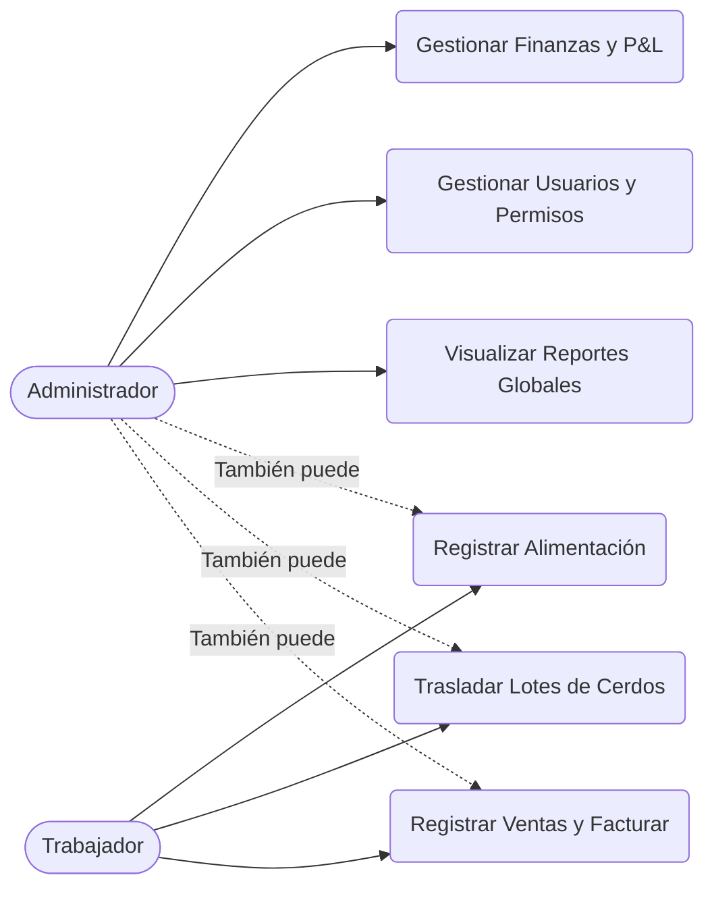

#### 1.2.2 Diagrama de Casos de Uso: Finanzas
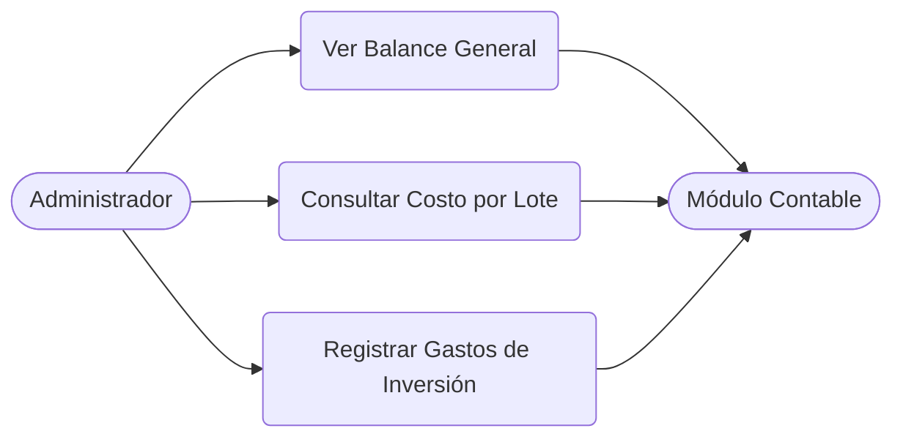

### 1.3 Análisis de Procesos de Negocio
Se han modelado los procesos operativos clave de la granja mediante diagramas de actividad.

#### 1.3.1 Flujo de Venta y Facturación
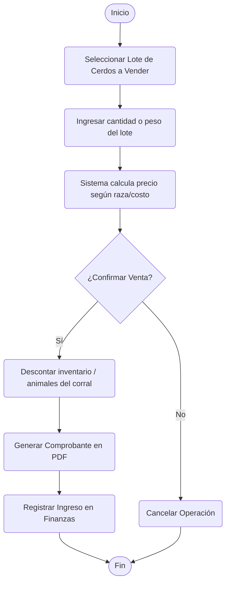

#### 1.3.2 Traslado de Lotes entre Corrales
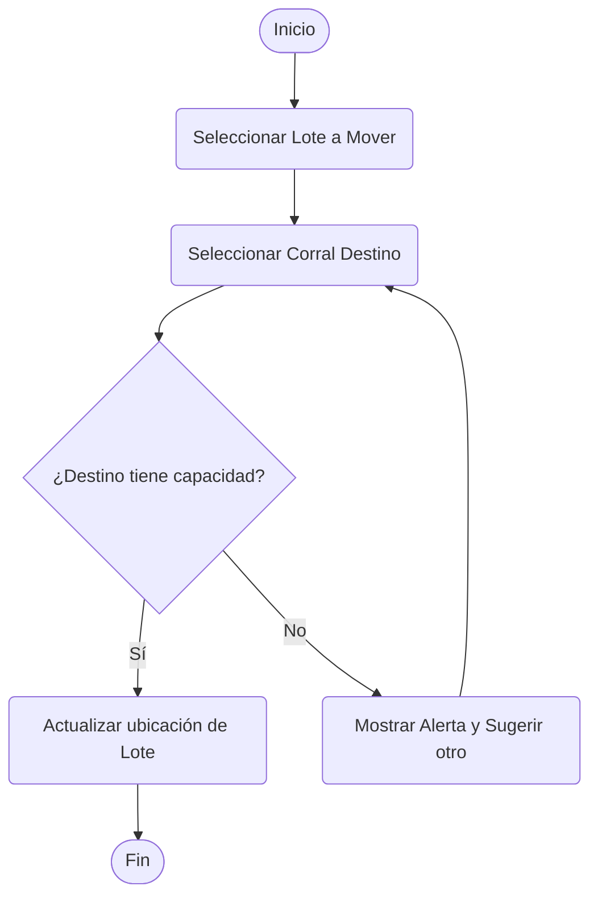

### 1.4 Máquinas de Estado
Diagramas que definen los diferentes estados de las entidades más críticas.

#### 1.4.1 Ciclo de Vida del Lote de Cerdos
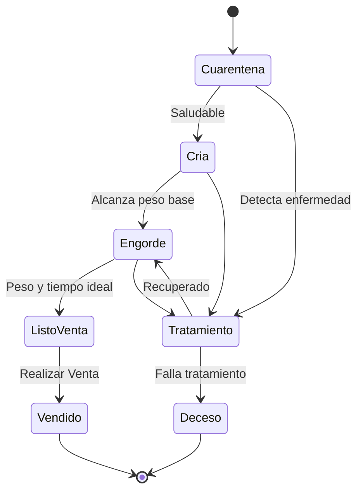

#### 1.4.2 Estados de una Factura
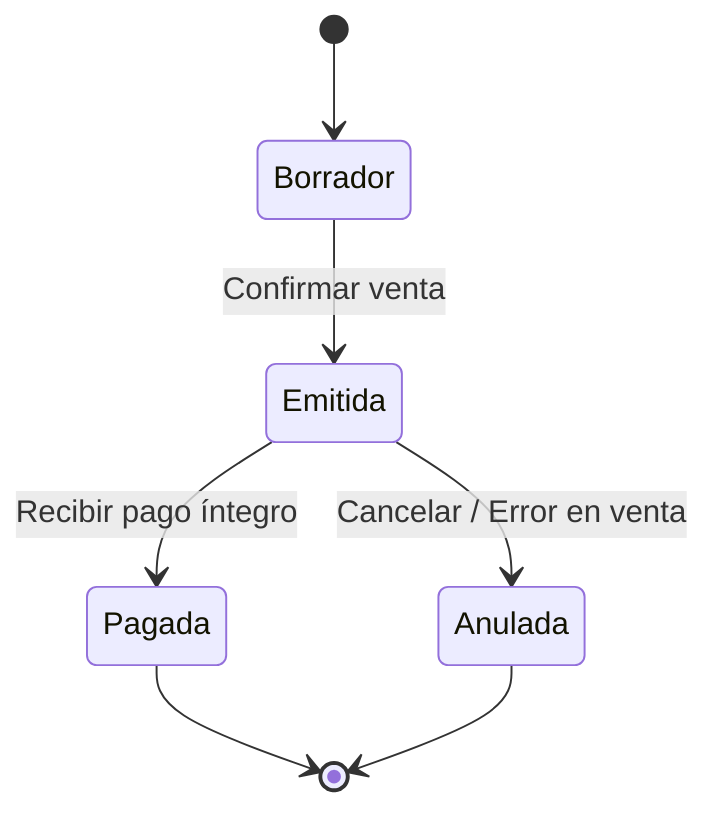

---

## 2. Análisis del Sistema de Base de Datos
Se utilizó PostgreSQL 16 para garantizar la integridad referencial y el manejo de grandes volúmenes de datos financieros y biológicos. La arquitectura de datos está diseñada para soportar la trazabilidad completa desde el nacimiento/compra del animal hasta su venta final.

### 2.1 Modelo de Dominio (Conceptual)
Antes de diseñar la base de datos física, se elaboró un modelo de dominio para entender los conceptos del negocio agrícola y cómo se relacionan entre sí.
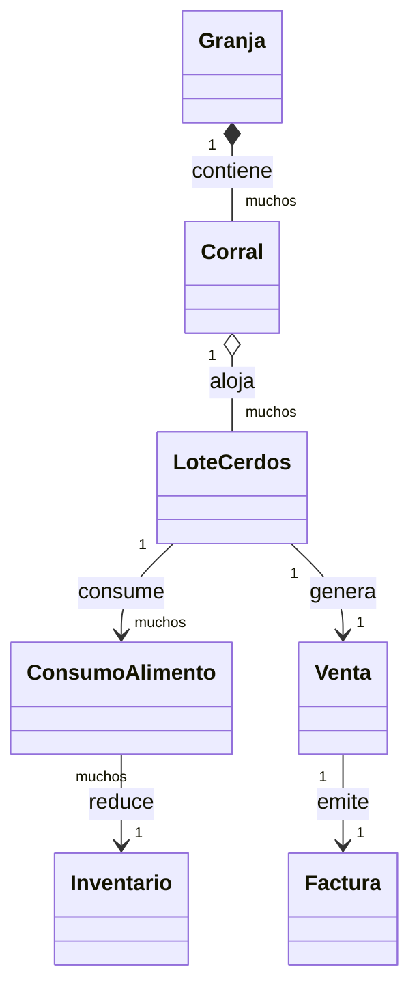

### 2.2 Modelo Entidad-Relación (ERD) Físico
El siguiente diagrama representa las tablas físicas y relaciones clave en la base de datos PostgreSQL.
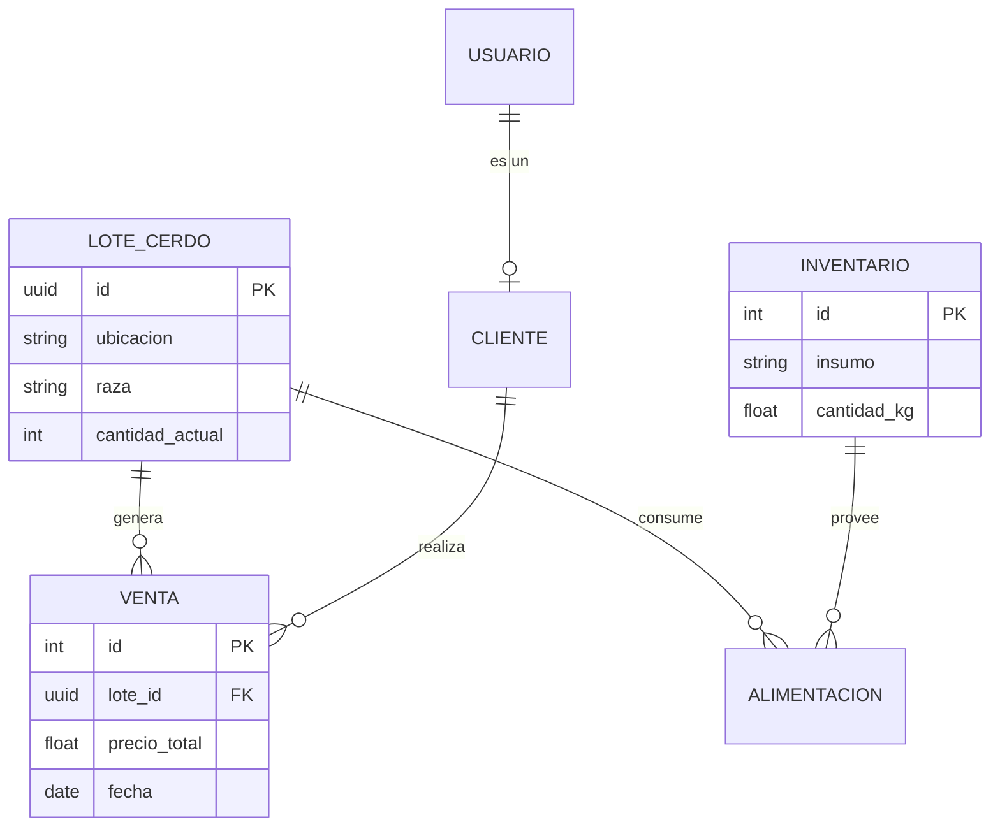

### 2.3 Diccionario de Datos Lógico

#### 2.3.1 Módulo de Producción (Granja)
*   **LoteCerdos**: Entidad principal para el engorde. Almacena biomasa, edad inicial, raza, estado y ubicación (corral).
*   **RegistroPeso**: Historial de crecimiento por lote para cálculo de conversión alimenticia.
*   **RegistroSalud**: Bitácora sanitaria de vacunas y tratamientos médicos aplicados.
*   **Cultivo**: Gestión de agricultura (Papaya/Plátano) con tracking de manzanas y estados de cosecha.

#### 2.3.2 Módulo de Inventario y Suministros
*   **Producto**: Catálogo de insumos (Alimento, Medicina, Herramientas) con control de stock mínimo y alertas.
*   **Proveedor**: Directorio de entidades que suministran recursos a la finca.
*   **ConsumoAlimento**: Relación crítica que vincula el inventario con el costo de producción de cada lote.

#### 2.3.3 Módulo de Ventas y Finanzas
*   **Venta / VentaDetalle**: Registro comercial que impacta directamente en el stock y genera movimientos contables.
*   **Transaccion**: Libro mayor que centraliza todos los ingresos (ventas) y egresos (compras/consumos), permitiendo el cálculo de rentabilidad en tiempo real.

### 2.4 Seguridad y Protección de Datos en la Base de Datos
Para garantizar la integridad y confidencialidad de la información, se han implementado las siguientes medidas de seguridad a nivel de datos:

1.  **Prevención de SQL Injection**: El sistema utiliza el **ORM de Django**, el cual parametriza automáticamente todas las consultas a la base de datos PostgreSQL, eliminando el riesgo de inyecciones de código malicioso mediante entradas de usuario.
2.  **Gestión Segura de Conexiones**: Las credenciales de la base de datos (Usuario, Password, Host, Port) no están "hardcodeadas" en el código fuente. Se gestionan mediante **Variables de Entorno (.env)**, asegurando que la configuración sensible permanezca aislada y protegida.
3.  **Cifrado de Credenciales**: Las contraseñas de los usuarios se almacenan utilizando algoritmos de hash robustos (PBKDF2 con SHA256), lo que garantiza que incluso en caso de una filtración de datos, las contraseñas originales no puedan ser recuperadas.
4.  **Control de Acceso basado en Roles (RBAC)**: Se han definido roles específicos que limitan las operaciones que cada usuario puede realizar en la base de datos, asegurando que solo el personal autorizado pueda modificar registros críticos como inventarios o transacciones financieras.

---

## 3. Diagnóstico de Arquitectura y SOLID
Tras la auditoría técnica, se identificaron desviaciones que fueron corregidas bajo los siguientes principios:

- **Single Responsibility Principle (SRP):** Se separó el cálculo de biomasa de la gestión de ventas.
- **Dependency Inversion Principle (DIP):** Se implementaron interfaces para los repositorios de datos.
- **Interface Segregation (ISP):** Las APIs de ventas son ahora granulares.

---

## 4. Validación y Pruebas de Carga de Datos
Para asegurar que el sistema es capaz de manejar el volumen de información operativa de la Finca la Primavera, se realizó una prueba de carga inicial superando los 200 registros en la base de datos PostgreSQL.

### 4.1 Generación de Datos Masivos
Se ejecutó un script de población automatizada (`populate_db_100.py`) que generó los siguientes registros de prueba:
- **Lotes de Cerdos**: 18 registros con historial de biomasa.
- **Productos en Inventario**: 20 tipos de insumos (Alimentos, Medicinas).
- **Clientes**: 10 perfiles registrados.
- **Ventas Realizadas**: 30 transacciones comerciales completas.
- **Detalles de Venta**: 58 líneas de detalle (vinculando lotes y productos).
- **Transacciones Financieras**: 95 registros de ingresos y egresos.
**Total de Registros Generados: 231**.

### 4.2 Pruebas de Query (Consultas de Validación)
Se validó la integridad de los datos mediante consultas SQL/ORM complejas:

1.  **Cálculo de Rentabilidad por Lote**:
    ```python
    # Query para obtener ingresos totales por venta de cerdos de un lote específico
    ingresos = VentaDetalle.objects.filter(lote_cerdos=lote).aggregate(Sum('subtotal'))
    ```
2.  **Alertas de Inventario Crítico**:
    ```python
    # Consulta de productos que están por debajo del stock mínimo
    alertas = Producto.objects.filter(cantidad__lt=F('stock_minimo'))
    ```
3.  **Balance de Caja Consolidado**:
    ```python
    # Cálculo de ingresos vs egresos totales
    total_ingresos = Transaccion.objects.filter(tipo='INGRESO').aggregate(Sum('monto'))
    total_egresos = Transaccion.objects.filter(tipo='EGRESO').aggregate(Sum('monto'))
    ```

Estas pruebas confirman que el diseño de la base de datos es eficiente y que las relaciones (Foreign Keys) están correctamente implementadas, permitiendo una trazabilidad total.

---

## 5. Diseño Arquitectónico y de Software
Esta sección describe la ingeniería interna del sistema, justificando la elección tecnológica y la estructura de componentes basada en estándares de alta calidad.

### 5.1 Arquitectura Preliminar y Patrones Estructurales
El proyecto implementa una arquitectura Cliente-Servidor separada.
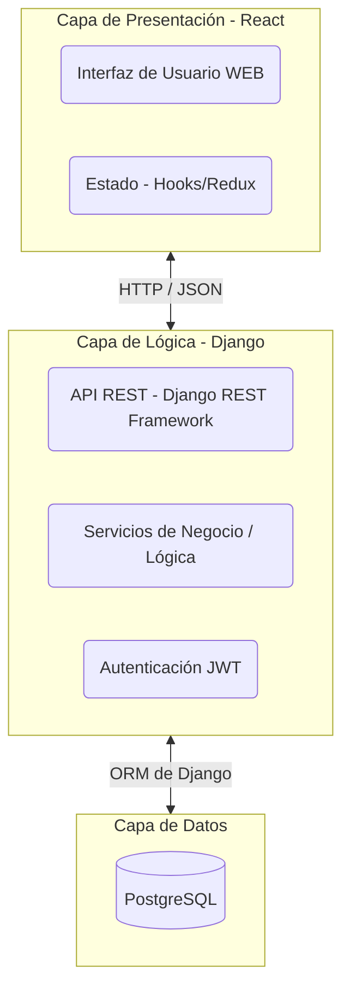

Adicionalmente, se utiliza el patrón de arquitectura de programas **MVC/MVT** (Modelo-Vista-Template/Serializador) en Django, representado de la siguiente forma:
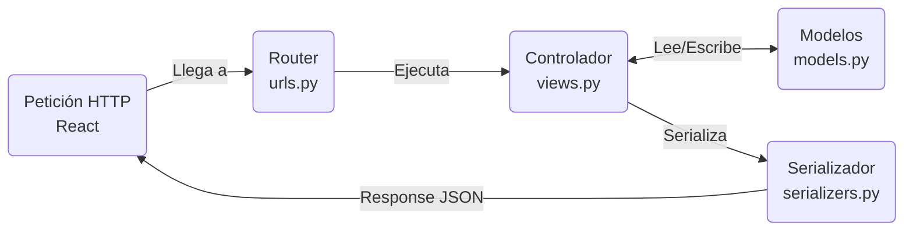

### 5.2 Diseño Orientado a Objetos (Clases y Objetos)
Para dar solución a la lógica de negocio, se diseñaron clases y objetos de ejecución específicos.

#### 5.2.1 Diagrama de Clases Detallado
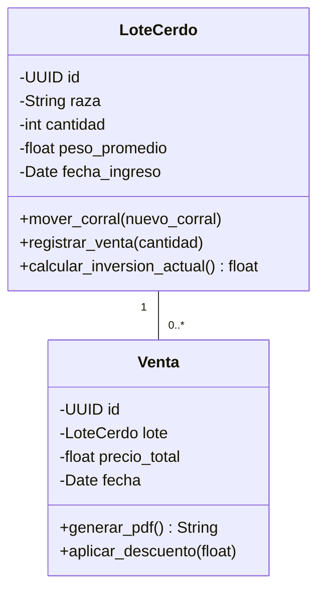

#### 5.2.2 Diagrama de Objetos (Instancias)
Objetos instanciados en memoria durante el registro de una transacción.
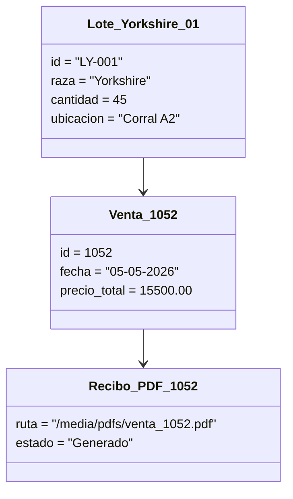

### 5.3 Aplicación de Principios SOLID y Programación Segura
El proyecto ha sido refactorizado para cumplir con los principios SOLID, garantizando un código robusto, escalable y fácil de mantener.

*   **Single Responsibility Principle (SRP)**: Cada módulo y clase tiene una única responsabilidad.
*   **Open/Closed Principle (OCP)**: El sistema está abierto a la extensión pero cerrado a la modificación. Se utilizan **Django Signals** para añadir funcionalidades.
*   **Liskov Substitution Principle (LSP)**: Todas las clases derivadas o implementaciones de interfaces pueden sustituirse sin alterar el comportamiento.
*   **Interface Segregation Principle (ISP)**: Se han creado serializadores y APIs granulares.
*   **Dependency Inversion Principle (DIP)**: Los módulos de alto nivel no dependen de módulos de bajo nivel.

#### 5.3.1 Diagrama de Componentes Físicos
Módulos de software y librerías clave interactuando.
```mermaid
flowchart TD
    subgraph Aplicación Cliente (Navegador)
        ReactApp[App.js - React]
        Axios[Cliente HTTP Axios]
        PDFViewer[Visor de PDF UI]
    end
    
    subgraph Servidor de API (Backend)
        URLs[Enrutador urls.py]
        Views[Views / services.py]
        Signals[signals.py - Finanzas]
        PDFGen[pdf_generator.py - ReportLab]
    end
    
    ReactApp --> Axios
    Axios -->|Peticiones REST| URLs
    URLs --> Views
    Views --> Signals
    Views --> PDFGen
    PDFGen -->|Retorna binario| PDFViewer
```

#### 5.3.2 Diagrama de Despliegue (Infraestructura)
Distribución física del software y hardware.
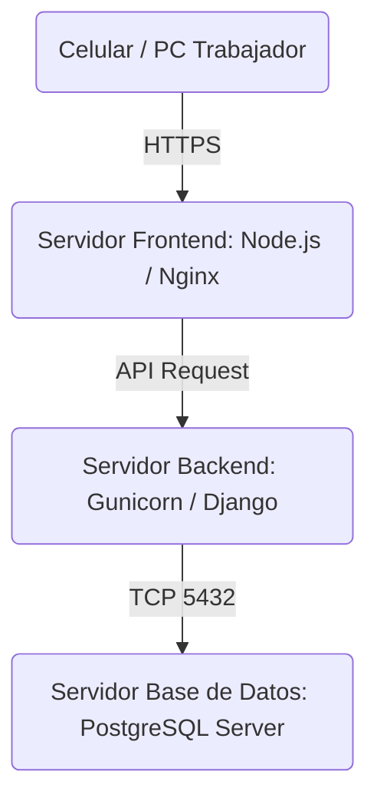

### 5.4 Estructura del Proyecto
El código se organiza en micro-módulos o "Apps" de Django para maximizar la mantenibilidad:
*   `granja`: Gestiona la lógica ganadera y biológica.
*   `inventario`: Controla los niveles de stock y alertas.
*   `finanzas`: Centraliza el libro contable y reportes P&L.

### 5.5 Diseño de Interfaz Interna e Interacción
El siguiente diagrama ilustra la comunicación entre React y la API durante una venta.
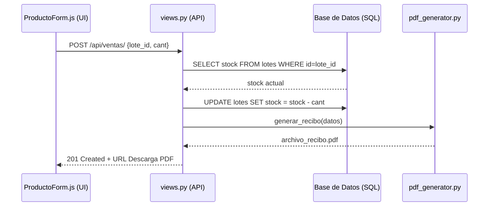

### 5.6 Secuencia de Sistema y Procesos
Las secuencias representan el orden lógico y temporal en que se ejecutan las interacciones entre los actores y el sistema.

#### 5.6.1 Secuencia de Sistema: Registro de Consumo
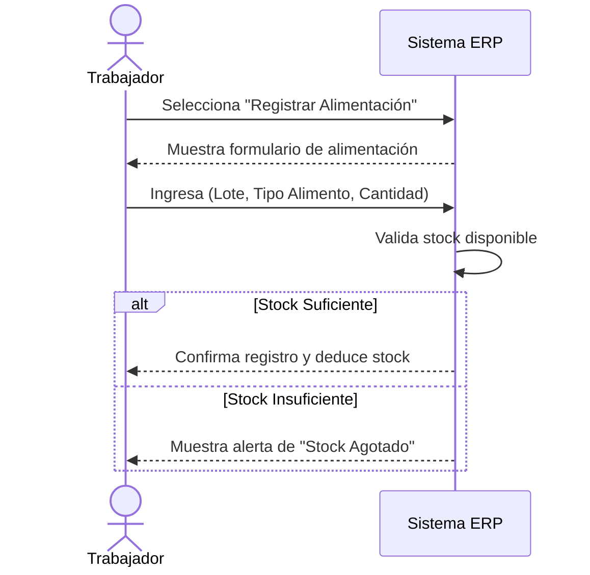

#### 5.6.2 Secuencia de Sistema: Reportes Financieros
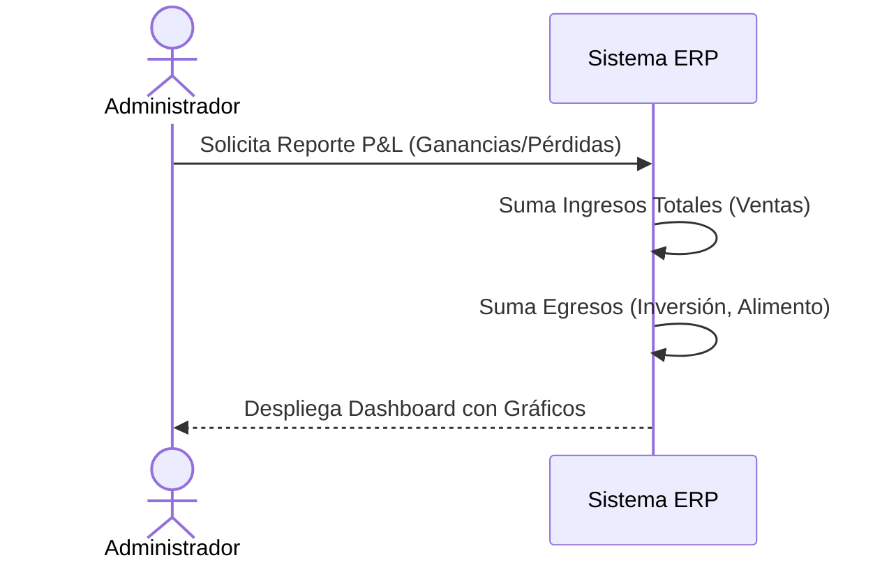

### 5.7 Manejo de Base de Datos y Patrones de Eventos
Para asegurar que los datos financieros siempre coincidan con la existencia física, se implementaron mecanismos asíncronos y **Triggers**. Un ejemplo crítico es la deducción automática de stock tras una venta mediante el **Patrón Observer**.

#### 5.7.1 Diagrama de Componentes y Eventos (Patrón Observer)
Implementación mediante Signals de Django (`finanzas/signals.py`).
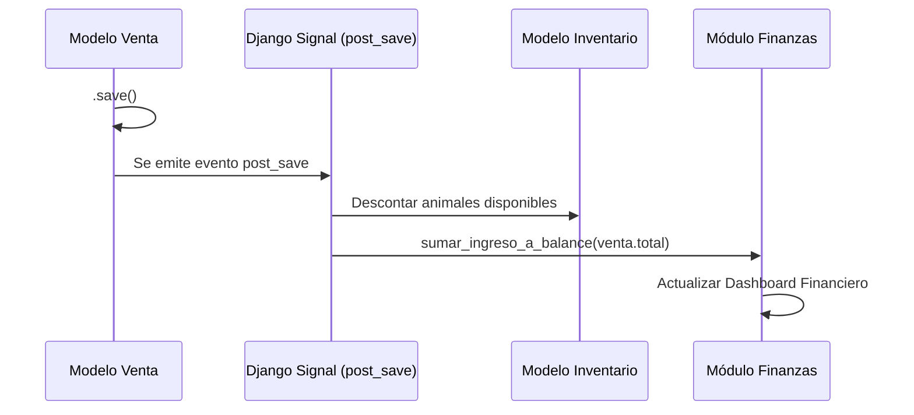

### 5.8 Inteligencia Artificial Aplicada
El sistema no solo fue desarrollado usando IA (Antigravity), sino que se integraron validaciones lógicas asistidas para detectar anomalías en los registros de peso y salud, actuando como una "capa de inteligencia" adicional en la granja.

---

## 6. Manual de Usuario Final
Este manual guía al usuario a través de la gestión integral de Finca la Primavera, desde el ingreso hasta el análisis de rentabilidad.

### 6.1 Panel de Inicio y Experiencia de Entrada
Al iniciar el sistema, el usuario es recibido por una **Landing Page Dinámica** inspirada en una estética rural clásica (Noche de Granja).
1.  **Acceso:** El usuario visualiza la marca de la finca en un estilo retro-pixelado.
2.  **Menú:** El acceso a los paneles administrativos se realiza a través de la barra lateral, que permanece oculta para maximizar el área de trabajo.

### 6.2 Dashboard de Rentabilidad Operativa
Es el "Cerebro" de la finca. Aquí el administrador visualiza:
*   **Tarjetas de KPI:** Muestran el total de lotes activos, el número total de cabezas y la biomasa total en kg.
*   **Monitor de Salud:** Un recuento en tiempo real de cuántos animales están en estado "Saludable", "Observación" o "Revisión".
*   **Gráfico P&L:** Un análisis visual de Ingresos vs. Egresos mensuales.

### 6.3 Módulo de Gestión Ganadera
Este módulo permite el control total del ciclo de vida del cerdo.
1.  **Registro Inteligente:** Al presionar "Nuevo Ingreso", se despliega un modal profesional.
2.  **ID Personalizado:** El usuario puede asignar un ID manual. El sistema **valida automáticamente** que el ID no esté repetido.
3.  **Cálculo Automático de Edad:** Al ingresar la "Edad al Entrar", el sistema actualiza los días de vida automáticamente.
4.  **Tabla Zebra:** La visualización usa un diseño de "cebra" con iconos de salud.

### 6.4 Módulo de Agricultura y Producción
Para la administración de Papaya y Plátano.
1.  **Registro de Manzanas:** Documenta la extensión de tierra dedicada.
2.  **Estimación de Cosecha:** Proyecta la cantidad a recolectar.
3.  **Estados de Crecimiento:** Crecimiento, Cosecha, Finalizado.

### 6.5 Administración de Insumos
Controla los recursos necesarios.
*   **Alertas de Stock:** Alimentos o vacunas bajo de 10 unidades alertan en rojo.
*   **Categorización:** Alimentos, Medicinas y Herramientas.

### 6.6 Registro de Ventas y Trazabilidad Comercial
1.  Se registra el cliente y el monto.
2.  El sistema **deduce automáticamente** las cabezas vendidas.
3.  Se genera un movimiento contable que impacta inmediatamente en Finanzas.

---

## 7. Pruebas del Sistema
Se implementó una estrategia de pruebas multinivel para garantizar la fiabilidad del ERP bajo condiciones reales de operación en la granja.

### 7.1 Pruebas Unitarias
Se seleccionaron pruebas unitarias para validar las funciones críticas de cálculo biológico y contable:
*   **Razón de Selección**: Estas funciones son el núcleo del sistema. Un error en el cálculo de la biomasa afectaría toda la contabilidad.
*   **Lo probado**: Cálculo automático de edad, actualización de stock tras señales de venta y validación de rangos de peso.

### 7.2 Pruebas de Integración (API)
Se verificó la comunicación entre los componentes de React y los Endpoints de Django.
*   **Razón de Selección**: Asegurar que la arquitectura desacoplada maneje correctamente los estados HTTP (201, 400, 403).
*   **Lo probado**: Flujo completo de registro de venta.

### 7.3 Pruebas de Programación Segura
Se realizaron pruebas de control de acceso basadas en roles.
*   **Razón de Selección**: Imperativo que un "Operador" no pueda modificar balances.
*   **Lo probado**: Intento de acceso a rutas protegidas sin el token JWT adecuado.

---

## 8. Documentación Técnica de Programación
El sistema sigue una arquitectura moderna centrada en el desarrollador para facilitar el mantenimiento a largo plazo.

### 8.1 Estructura del Código
*   **Backend (Django)**: Organización por aplicaciones funcionales. Sigue el patrón **Skinny Views, Fat Models/Services**.
*   **Frontend (React)**: Componentes funcionales con Hooks (useState, useEffect) y una estructura atómica.
*   **Control de Versiones**: Uso de Git con mensajes descriptivos.

### 8.2 Entorno de Desarrollo y Despliegue
*   **Dependencias**: `requirements.txt` (Backend) y `package.json` (Frontend).
*   **Servidor de Base de Datos**: PostgreSQL 16 con backups automáticos.
*   **Variables de Entorno**: Archivo `.env` para aislamiento de secretos.

---

## 9. Bibliografía
- *Martin, R. C. (2017). Clean Architecture: A Craftsman's Guide to Software Structure and Design.*
- *Official Django Documentation (v4.2). https://docs.djangoproject.com/*
- *React - The Library for Web and Native User Interfaces. https://react.dev/*
- *Normas APA 7ma Edición.*

---

## 10. Anexos
1. Evidencia de validación de IDs duplicados.
2. Reporte de biomasa generado por el sistema.
3. Capturas del modal de registro y la tabla Zebra.
4. Log de ejecución del script `populate_db_100.py` (231 registros creados).
